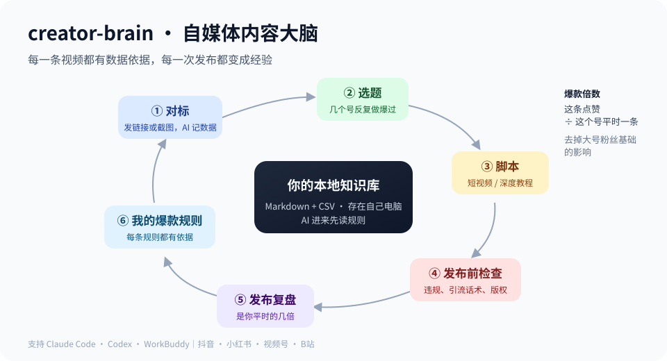

# creator-brain

[简体中文](README.md) | **English**

An agent skill for content creators (Douyin, Xiaohongshu, WeChat Channels, Bilibili and similar platforms). Once installed, your AI agent (Claude Code, Codex, WorkBuddy, …) builds a local creator knowledge base and works through a fixed method:

- **Benchmarks**: send a profile link or a screenshot; the agent records the numbers and works out each account's typical likes per post.
- **Topics**: the *hit multiple* (a post's likes ÷ that account's median likes) shows which topic types were hits for several accounts recently.
- **Scripts**: templates for ~2-minute short videos and long tutorials, plus a pass that makes the script sound like a real person.
- **Pre-publish check**: common risks such as absolute claims, off-platform contact details, copyright and AI-content labels.
- **Retro**: day-3 and day-7 numbers for each of your posts, how many times your own median it reached, and one written takeaway.
- **Private traffic**: what to give away, where to receive followers, and how to track results.

Everything is plain Markdown and CSV on your own computer. No upload, no database.

## Install

Copy `skills/creator-brain` into your agent's skill folder (for example `~/.claude/skills/creator-brain` or `~/.codex/skills/creator-brain`), or ask your agent to install it from https://github.com/thanhvietp02-dotcom/creator-brain . Python 3.9+ is required; only the standard library is used.

Then tell your agent: "Use creator-brain to set up a creator knowledge base in <folder>." It shows a preview first and never overwrites existing files.

## Scripts

| Script | Purpose |
|---|---|
| `init_vault.py` | Create the vault skeleton (preview by default) |
| `viral_score.py` | Hit multiples and repeatedly-validated topic types from benchmark data |
| `retro.py` | Your own baseline and each post's multiple |
| `health_check.py` | Read-only check for broken links, orphan notes, inbox backlog, likely secrets |
| `search.py` | Local full-text search (CJK bigrams) |

Fictional sample data lives in `examples/`. Run the tests with `python -m unittest discover tests`.

## License

[MIT](LICENSE)
