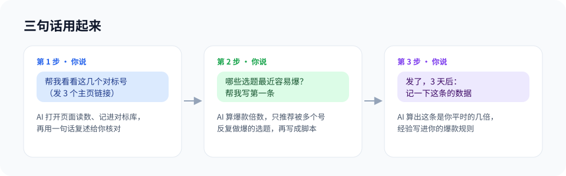

# creator-brain：自媒体内容大脑

**简体中文** | [English](README.en.md)

[](https://github.com/thanhvietp02-dotcom/creator-brain/actions/workflows/test.yml)
[](CHANGELOG.md)
[](LICENSE)
[](https://github.com/thanhvietp02-dotcom/creator-brain/stargazers)


给做自媒体的人用的 AI 知识库。装上以后，你的 AI 会在你电脑上建一个内容库，然后陪你把每条内容从头做到尾：看对标、挑选题、写稿、发前检查、发后复盘。做得越多，它越懂你的号。

## ⚡ 30 秒装好

把下面这段话发给你的 AI（Claude Code、Codex、WorkBuddy 都行），把文件夹换成你自己的：

```text
帮我安装 creator-brain 这个 Skill，地址是 https://github.com/thanhvietp02-dotcom/creator-brain 。
把仓库里的 skills/creator-brain 文件夹装到你的 Skill 目录里。装好以后调用它，
在「D:\我的自媒体」搭一个自媒体知识库。开始前先问我几个问题，了解我的账号；
先给我看预览，我确认了再建。
```

## 🚀 用起来就三句话



不用填任何表格。看对标号的时候发个主页链接，AI 打不开网页的话截几张图给它也行。数据它自己记，记完跟你说一句"这个号平时一条大概 800 赞，最火那条是平时的 20 倍"，你看对不对。

## 🧰 它能帮你干这些

**看对标。** 发链接或截图，它记数据、建账号卡，算出每个号平时什么水平、哪几条是真爆。

**挑选题。** 把对标号的作品按选题类型归类，告诉你最近哪几类被好几个号反复做爆。分类可以改成你自己领域的说法。

**写稿子。** 2 分钟左右的短视频，或者一步步带着做的深度教程。开头给你 3 个写法挑，写完再过一遍，把一听就是 AI 写的话改掉。

**发布前检查。** 夸大的说法、在视频里留联系方式、背景音乐版权、AI 内容要不要标注，常踩的坑挨个查，告诉你哪句必须改。

**发布后复盘。** 发完第 3 天、第 7 天说一下数据，它算出这条是你平时的几倍。同一个原因出现两次，就记进你的「爆款规则」，下次写稿先看这份规则。

**私域引流。** 送什么、在哪接住人、效果怎么记，时间长了就知道哪种方式对你最管用。

## 🔍 为什么看「爆款倍数」


大号随便一条都有几万赞，那是粉丝撑起来的。小号一条做到平时的几十倍，才说明选题本身起了作用。所以它挑选题时主要看三点：最近有几个号做爆过、小号有没有做爆过、收藏多不多。

## 🤔 直接问豆包、ChatGPT 不就行了？

可以问，但它们不认识你。它没看过你的对标号，不知道你上一条为什么没火，换个对话又全忘了。

creator-brain 把你的定位、对标、发过的每一条和成绩、你自己总结的规律，都存在你电脑上的一个文件夹里。AI 每次干活前先读这些，给的建议是针对你这个号的。

## 📊 跑出来是什么样

用仓库里的示例数据跑的（账号和数字都是编的）：

| 推荐 | 选题类型 | 爆款条数 | 做爆的号数 | 小号也爆 | 最近一次 | 收藏/点赞 |
|---|---|---:|---:|---:|---|---:|
| ✅ | 新手入门教程 | 4 | 4 | 3 | 2026-10-23 | 0.82 |
|  | 清单推荐 | 2 | 2 | 1 | 2026-10-09 | 1.00 |
|  | 对比测评 | 1 | 1 | 0 | 2026-10-14 | 0.80 |

## 🗂️ 知识库长什么样

就是你电脑上一个普通文件夹，用 [Obsidian](https://obsidian.md) 或记事本都能打开。

```text
我的自媒体/
├── AGENTS.md        写给 AI 的规矩，它每次进来先读
├── 00.收件箱/       没整理的东西先扔这里
├── 01.账号定位/     我是谁、做什么、给谁看
├── 02.对标库/       对标号的账号卡、数据、拆解
├── 03.用户洞察/     粉丝的问题和原话
├── 04.素材库/       能用进视频的案例和截图
├── 05.选题池/       一个选题一张卡
├── 06.内容生产/     稿子的草稿和定稿
├── 07.发布与复盘/   发过的每一条和它的成绩
├── 08.私域与转化/   引流方案和效果
└── 09.我的方法论/   我的爆款规则
```

## 💬 平时可以这么跟它说

- 「这个号帮我看看」+ 主页链接
- 「最近哪些选题容易爆？」
- 「帮我写个 2 分钟的口播，主题是……」
- 「这稿子太像 AI 写的了，改改」
- 「发之前帮我查一遍」
- 「记一下这条的数据：3 天 2 万播放，800 赞」
- 「我之前记过关于 XX 的东西吗？」

## 🙅 它不干的事

- 不替你发视频、发评论、发私信，关键几步都会等你点头。
- 不批量抓数据，只看你打开的页面和你发的截图。
- 不用服务器，资料全在你自己电脑上。
- 不替你编经历，需要你自己例子的地方会空出来让你填。

## ❓ 常见问题

**数据会上传吗？** 不会，知识库就在你电脑上。只有跟 AI 对话时，AI 读到的内容会经过你用的那个 AI 服务。

**只能做抖音吗？** 小红书、视频号、B站、快手都能用。

**不会写代码能用吗？** 能，全程只需要跟 AI 说话、发链接或截图。

## 🛠️ 手动安装

下载这个仓库，把 `skills/creator-brain` 文件夹复制到：

| 工具 | 放到哪 |
|---|---|
| Claude Code | `~/.claude/skills/creator-brain` |
| Codex | `~/.codex/skills/creator-brain` |
| WorkBuddy 和其他工具 | 它的 Skill 目录，或者直接让它读 `skills/creator-brain/SKILL.md` |

电脑上要有 Python 3.9 以上。想先试试，`examples/` 里有示例数据，用法见 [examples/README.md](examples/README.md)。

## 📝 更新记录

当前 v0.1.0，见 [CHANGELOG.md](CHANGELOG.md)。

## 👋 作者

抖音搜 **锐知Mind**。用着有问题或者想加功能，欢迎提 [Issue](https://github.com/thanhvietp02-dotcom/creator-brain/issues)；觉得有用，点个 ⭐。

[](https://star-history.com/#thanhvietp02-dotcom/creator-brain&Date)

## 许可

[MIT](LICENSE)
